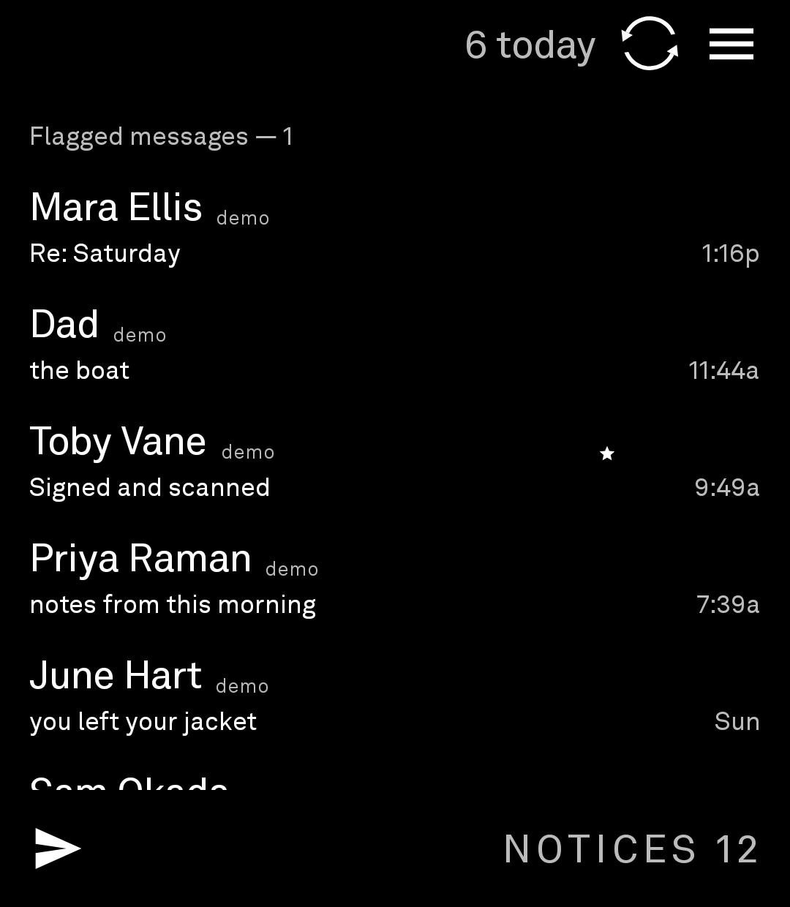
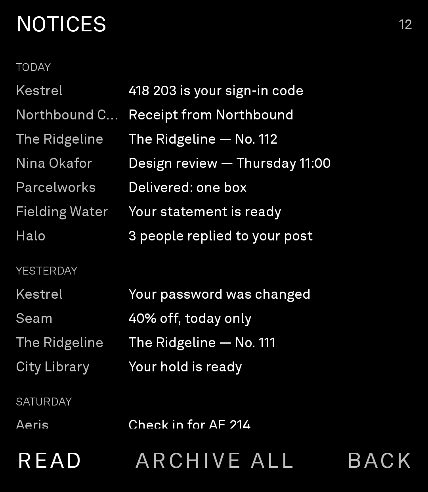
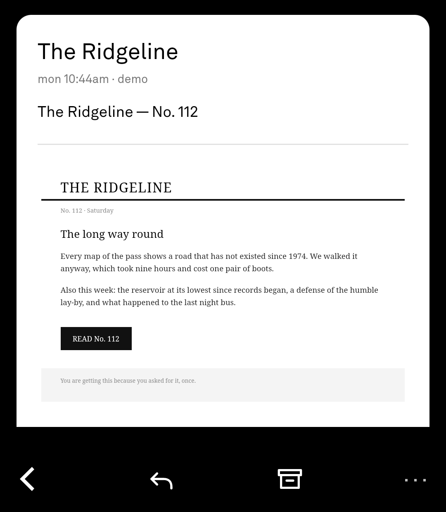

<a href="https://github.com/sponsors/gi-os"></a>

# Mailbox

[**⬇ Download the latest APK**](https://github.com/gi-os/BrightMailbox/releases/latest) · free, open source.

An email client for the Light Phone III that sorts your mail into two piles and then
gets out of the way.

**Letters** are messages a human wrote to a human. They get the whole screen, one at a
time, set like a page of a book. **Notices** are everything a machine sent — receipts,
shipping updates, 2FA codes, newsletters, password resets. They collapse to one line
each and never make a sound.

You set a daily ration. Five Letters a day, or unlimited. At five, when you have read
them, the app says so and there is nothing left to scroll.

Gmail with an app password. Outlook with one tap. Nothing to register.

---

## Screenshots

<p>
  
  
  
</p>

The day's Letters with the ration in the header; the Notices pile, one line each and
grouped by day; and a message rendered the way its sender built it, laid out at the width
it declares and scaled to the panel.

The mail in them is invented, so nothing above is anybody's real correspondence.

---

## Signing in

**Gmail** takes a sixteen-character app password from
`myaccount.google.com/apppasswords`. No Google Cloud project, no consent screen, no
"Google hasn't verified this app" warning. Make the password on a computer, put it into
<https://gi-os.github.io/BrightMailbox/>, and scan the QR — or type it, if you prefer a
3.9-inch keyboard to a camera.

**Outlook** takes one tap, once the build has a client id. Microsoft finished retiring
Basic auth for IMAP in April 2026, so it has to be OAuth — there is no app-password route
for Outlook in any client, because app passwords are Basic auth and went with it. The
saving grace is that Microsoft caps nothing, so one registration covers everybody. A
build made without that id says so on the row and takes the id when you tap it.

The asymmetry is not an accident and it is worth knowing, because it reverses what most
people assume. Every Google scope that can read mail is **restricted**: capped at 100
users until the app passes a CASA Tier 2 audit, which costs four figures a year. Version
1 dodged the cap by making each user register their own Cloud project — eleven steps,
ten minutes, and the step people missed produced a sign-in that worked and then returned
403 on every request. An app password has no cap, no console and no audit.

So the older mechanism is the one that scales, and **Outlook is now the easy one**.

[SETUP.md](SETUP.md) has both procedures.

## Why IMAP rather than the REST APIs

The point is not the protocol — it is the sorting — but the protocol decided who could
use the app.

There is a second reason: it is faster. Gmail's REST API has no batch metadata read, so
version 1 issued one HTTP GET per message and a first sync was four hundred round trips.
One IMAP FETCH with a HEADERS profile pulls four hundred headers in a couple of round
trips on a single connection.

MIME parsing comes from [Angus Mail](https://eclipse-ee4j.github.io/angus-mail/), which
publishes a supported Android build. IMAP is simple enough to write by hand; MIME is
not, and MIME is what breaks a mail client on one message in twenty.

## How the sorting works

Two tiers, and the division of labor matters.

### Tier 0 — headers decide the pile

Deterministic, offline, microseconds, no model. A machine that sends mail in bulk is
required by convention to say so, and it does: `List-Unsubscribe` (RFC 2369),
`Precedence: bulk` (RFC 2076), `Auto-Submitted` (RFC 3834), `X-Auto-Response-Suppress`,
a VERP return path, a `no-reply@` sender.

Above all of those sits one rule: **have you ever replied to this address**. Someone you
have written back to is a person, whatever headers their mail carries. That signal is
read once from your Sent folder at setup, and it is why the app gets better the longer
you use it.

The rules are deliberately narrow in one direction. `hello@`, `team@`, `contact@` and
`info@` are *not* treated as robots, even though they look like it, because at a small
company that is exactly where a real person writes from. A false Notice costs you a
missed client reply; a false Letter costs one line on a screen.

### Tier 1 — a small learned model ranks what is left

Logistic regression over hashed n-grams. About 200 KB of weights, trained on device from
your own mailbox in roughly a second, updated instantly whenever you correct it.

Its job is to decide which five Letters are worth today's ration, and to absorb
corrections so a misfile is permanent knowledge rather than an annoyance. It is allowed
to move a message between piles only when the headers had nothing to say and it is very
confident — never against an explicit marker. A `List-Unsubscribe` header is a fact; a
model output is an opinion, and an opinion does not get to bury your mail.

### Why not an LLM

It was considered seriously and measured. A Gemma-class model needs two to five seconds
of prefill per message on the LP3's Snapdragon 4 Gen 2; a first sync of 200 messages
would spend ten minutes pegging the CPU against an 1800 mAh battery, add ~200 MB to the
install, and still be worse at *this particular question* than three headers are.

The local model that earns its place here is 200 KB, not 200 MB.

### It has to be inspectable

Every message can tell you why it landed where it did, in plain words — *"has an
unsubscribe link"*, *"you've replied to this address 34 times"*. Never a percentage,
never a confidence bar. Moving a sender between piles is one action, it is reversible,
and it says what it learned. Every override you make is listed in Settings and can be
removed.

Automation you cannot see or undo is not worth shipping.

## Notifications

**Letters notify. Notices never do.** That one rule is most of the reason to install
this instead of any other mail client.

Mailbox posts a standard notification at importance ≥ 3 and lets **BrightControl** draw
the banner and the lock-face row — it has done that for any app since v3.65. Mailbox
deliberately does not draw its own heads-up box, which would stack a second one on top.

### Sounds

Three, in this order: **Default** (whatever LightOS uses), **You've Got Mail**, and
**Music Box**. Plus a custom slot that points at any file you like.

No audio is committed to this repository. Every sound is synthesized at build time from
about 15 KB of Python — modal synthesis for the chimes, and a Klatt-style cascade
formant synthesizer for the voice, driven by measured articulation data. See
[scripts/README.md](scripts/README.md), which has the numbers.

The famous recording is Elwood Edwards' 1989 performance for AOL and it belongs to
somebody. Playing your own copy on your own phone is ordinary personal use; shipping it
inside an APK is redistribution, and the MIT license on this repo would then be making a
false claim to anyone who forks it. So the bundled one is synthesized, and there is a
**Custom** row for people who have the real thing.

## Building

```
./gradlew :app:assembleRelease
```

Needs `python3` with `numpy` for the sound generation. Without it the build still
succeeds and the app falls back to the system notification sound.

### The Microsoft client id

One id, for Outlook only — Gmail has none any more. It is not required at build time:
ADD OUTLOOK on a build without one asks for the id and stores it beside the credentials,
which is what makes a plain release APK usable by anyone. A public client has no secret
to leak, and the redirect scheme is fixed by the package name rather than by the id, so
this is not a credential being typed into a phone — it is a name.

Changing it signs the Microsoft accounts out. A refresh token belongs to the client that
issued it, so the old ones are already dead; dropping them beats leaving rows that fail
on the next sync with no explanation.

To bake it in, put it in `local.properties`:

```
microsoftClientId=00000000-0000-0000-0000-000000000000
```

Register it as a **multi-tenant public client** with the redirect
`com.gios.brightmailbox://oauth2redirect`, and grant the delegated permissions
`IMAP.AccessAsUser.All` and `SMTP.Send` — not the Graph `Mail.*` ones. A token minted
for Graph scopes is refused by the IMAP server with a bare AUTHENTICATE failure and no
explanation, which is a long afternoon if you do not know it.

### If the browser eats the redirect

`scripts/authorize.py` runs consent on a computer and hands the phone a refresh token by
QR. Gmail no longer needs it — an app password is typed straight in.

## Giovanni: rotate BrightMailbox release signing

`./gradlew :app:assembleRelease` builds an unsigned APK. Debug builds use the standard
Android debug key, which varies across CI runners. Use a local build for repeat debug
installs; a debug APK cannot update a production install. The **Check** workflow tests
signing with disposable keys and never publishes.

Before merging this change, disable [Build & Release APK](https://github.com/gi-os/BrightMailbox/actions/workflows/build.yml).
Run `gh workflow disable build.yml --repo gi-os/BrightMailbox`.
A push to `main` otherwise publishes. Keep it disabled until the rotation and distribution
checks below are done and you intend to publish.

In a private directory outside the checkout, use Android Build Tools 35.0.0. Use the
original `keystore/brightmailbox.jks` from Git history before the key was removed and its existing
passwords only for the offline rotation step. Use fresh passwords for the new key.

The original SHA-256 pin is `ab866f2a03fcd4d8e88d2da1bb3e295d080ac28f46ae6c5bb8c9b9d9cc9e23c9`:
it matches the historical keystore, the published v2.70.76 APK signer and the
`com.gios.brightmailbox` signer in the [live BrightMarket catalog](https://brightmarket.gzl.dev/index-v1.json).

```sh
umask 077
keytool -genkeypair -storetype JKS -keystore brightmailbox-new.jks -alias brightmailbox-release \
  -keyalg RSA -keysize 3072 -validity 10000

apksigner rotate --out brightmailbox.lineage \
  --old-signer --ks /path/to/original/brightmailbox.jks --ks-key-alias brightmailbox \
  --set-installed-data true --set-rollback false \
  --new-signer --ks brightmailbox-new.jks --ks-key-alias brightmailbox-release

apksigner lineage --in brightmailbox.lineage --print-certs
```

Verify signer #1's SHA-256 digest against `signing-lineage-root-fingerprint.txt` and
replace `signing-fingerprint.txt` in this PR with signer #2's SHA-256 digest. Do not
change the original pin. The release won't publish while the pins are still identical.

In [BrightMailbox's environment settings](https://github.com/gi-os/BrightMailbox/settings/environments),
create an environment named `release`. Under **Deployment branches and tags**, choose
**Selected branches and tags** and add a single **Branch** rule for `main`, with no tag
rules. Add the five secrets below to that environment only. Do not use repository-wide
secrets or upload the original key or its passwords.

| Secret | Value |
| --- | --- |
| `RELEASE_KEYSTORE_BASE64` | Base64-encoded `brightmailbox-new.jks` |
| `SIGNING_LINEAGE_BASE64` | Base64-encoded `brightmailbox.lineage` |
| `KEYSTORE_PASSWORD` | New keystore password |
| `KEY_ALIAS` | `brightmailbox-release` |
| `KEY_PASSWORD` | New key password |

On Linux, stream the files and enter the passwords at the prompts:

```sh
base64 -w 0 brightmailbox-new.jks | gh secret set RELEASE_KEYSTORE_BASE64 --env release --repo gi-os/BrightMailbox
base64 -w 0 brightmailbox.lineage | gh secret set SIGNING_LINEAGE_BASE64 --env release --repo gi-os/BrightMailbox
gh secret set KEYSTORE_PASSWORD --env release --repo gi-os/BrightMailbox
gh secret set KEY_ALIAS --env release --repo gi-os/BrightMailbox --body brightmailbox-release
gh secret set KEY_PASSWORD --env release --repo gi-os/BrightMailbox
```

Delete old repository-level signing secrets in
[Actions secrets](https://github.com/gi-os/BrightMailbox/settings/secrets/actions),
including `KEYSTORE_B64`, `KEYSTORE_PASSWORD`, and any repository-level copies of the
five names above. Do not delete unrelated application secrets.

CI supplies only the new private key to `scripts/sign-release.sh` and checks that the APK's
v3 lineage links both pins, preserves installed data, and disallows signer rollback. API 29+
does not need v1/v2 signatures. Removing the old key from the branch does not remove it
from Git history or protect installs that still trust it.

Before re-enabling publishing, verify an in-place update from the last shipped build to a
locally signed test APK with a greater `versionCode` on a device with no real bank data.
Coordinate the BrightMarket migration: add the exact old-to-new `com.gios.brightmailbox`
handover to [the index](https://github.com/gi-os/brightmarket-index/blob/HEAD/scripts/build_index.py)
using this entry in `HANDOVERS` (replace the placeholder with the new lowercase,
colon-free SHA-256; never commit the placeholder):

```python
(
    "com.gios.brightmailbox",
    "ab866f2a03fcd4d8e88d2da1bb3e295d080ac28f46ae6c5bb8c9b9d9cc9e23c9",
    "<NEW_CERT_SHA256>",
    "Rotate release signing key exposed with its password in Git history",
),
```

Ensure [the updater](https://github.com/gi-os/BrightMarket) accepts the installed
predecessor for this transition. The index otherwise keeps the old release, and changing
the catalog pin alone makes the current updater classify old installs as foreign.

Only after the pins, environment and distribution checks are complete, re-enable with
`gh workflow enable build.yml --repo gi-os/BrightMailbox` when ready to publish.

## Testing

The `sort/`, `text/` and `mail/Addr` packages have no Android imports, so they run on a
plain JVM:

```
./gradlew :app:testDebugUnitTest
```

48 tests covering the header rules, the learned model, the two-tier interaction, quote
and signature stripping, and address parsing. The classification is the product, so it
is the part that stays verifiable.

## Design

Built to the LightOS design system rather than an approximation of it: the 27 × 31
`LightGrid`, the named type scale (`designVerticalPxToSp`), three values and no fourth,
no ripples, a 45 ms haptic on finger-down. Units scale on width, type scales on height —
mixing those is what makes bars and text drift apart.

Body leading is locked to exactly two grid units, so every line of every Letter lands on
shared baselines and one wheel notch moves a whole number of lines. Nothing ever
half-clips at the fold.

## License

MIT.

## Support

These apps are free, open, and built on my own time. Sponsorship pays the bills that don't go away: build servers, test hardware, and the crash reporter that keeps them shipping. Donation or not my code is always free for the world to use.

[Sponsor on GitHub](https://github.com/sponsors/gi-os)
